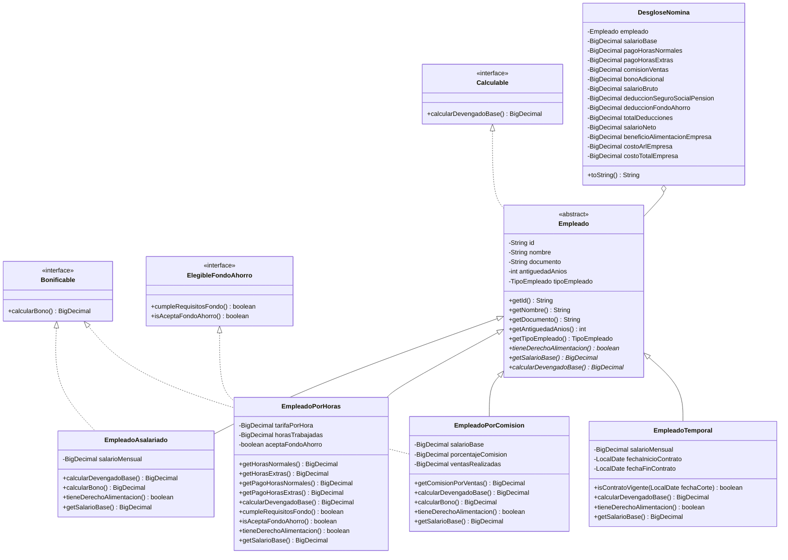
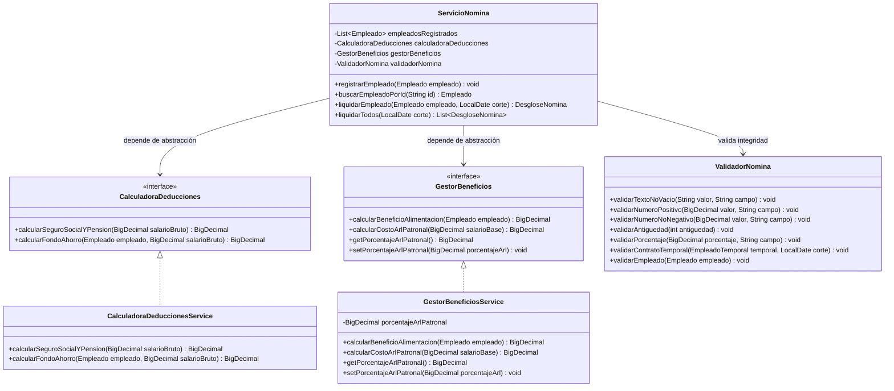
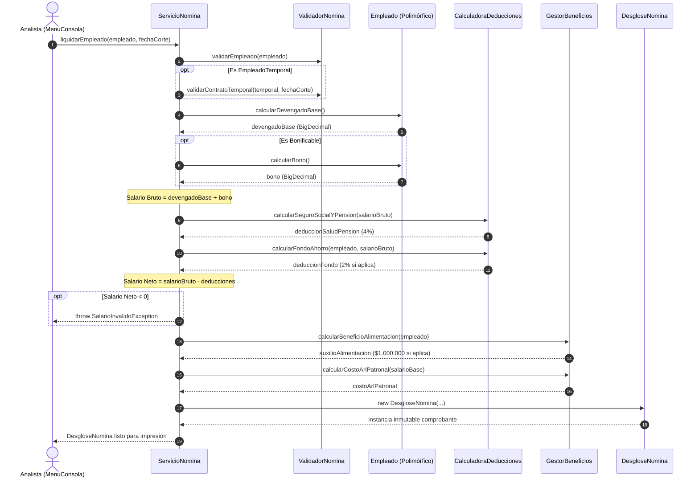

# Arquitectura y Diseño Orientado a Objetos

## Proyecto CIPA — Modalidad Individual
**Estudiante:** Andrés Felipe Guzmán Arrieta  
**Programa:** Ingeniería de Software  
**Institución:** Universidad de Cartagena  

---

## 1. Descripción General de la Arquitectura
El sistema de nómina ha sido diseñado adoptando una **arquitectura en capas desacopladas**, orientada al dominio y guiada por los principios de la Programación Orientada a Objetos (POO) y SOLID. La arquitectura aísla completamente las reglas de negocio y el cómputo salarial de la capa de presentación (consola), permitiendo que el motor de nómina pueda ser reutilizado o integrado en el futuro con interfaces gráficas (JavaFX/Swing), servicios web (REST API con Spring Boot) o motores de persistencia en bases de datos relacionales sin requerir modificaciones en la lógica central.

### Capas del Sistema:
1. **Capa de Modelo (`com.cipa.nomina.model`):** Define las entidades del dominio, contratos de interfaces y representaciones inmutables de los resultados de liquidación.
2. **Capa de Validación (`com.cipa.nomina.validation`):** Centraliza las reglas de integridad de datos y condiciones de borde de negocio.
3. **Capa de Servicios (`com.cipa.nomina.service`):** Orquesta los cálculos, la inyección de componentes de deducción y beneficios, y la ejecución polimórfica.
4. **Capa de Excepciones (`com.cipa.nomina.exception`):** Jerarquía de excepciones de dominio para el reporte explícito de fallos.
5. **Capa de Presentación (`com.cipa.nomina.ui` y `Main`):** Gestiona la interacción con el usuario mediante consola interactiva en lenguaje natural.

---

## 2. Diagrama de Paquetes y Estructura del Proyecto

```
sistema-nomina-cipa/
├── pom.xml
├── README.md
├── .gitignore
├── docs/
│   ├── requisitos.md
│   ├── arquitectura.md
│   ├── metodologia.md
│   ├── casos-de-prueba.md
│   ├── informe-academico.md
│   └── guion-video.md
└── src/
    ├── main/
    │   └── java/
    │       └── com/cipa/nomina/
    │           ├── Main.java
    │           ├── exception/
    │           │   ├── NominaException.java
    │           │   ├── ValidacionException.java
    │           │   └── SalarioInvalidoException.java
    │           ├── model/
    │           │   ├── Bonificable.java
    │           │   ├── Calculable.java
    │           │   ├── ConstantesNomina.java
    │           │   ├── DesgloseNomina.java
    │           │   ├── ElegibleFondoAhorro.java
    │           │   ├── Empleado.java
    │           │   ├── EmpleadoAsalariado.java
    │           │   ├── EmpleadoPorComision.java
    │           │   ├── EmpleadoPorHoras.java
    │           │   ├── EmpleadoTemporal.java
    │           │   └── TipoEmpleado.java
    │           ├── service/
    │           │   ├── CalculadoraDeducciones.java
    │           │   ├── CalculadoraDeduccionesService.java
    │           │   ├── GestorBeneficios.java
    │           │   ├── GestorBeneficiosService.java
    │           │   └── ServicioNomina.java
    │           ├── ui/
    │           │   └── MenuConsola.java
    │           └── validation/
    │               └── ValidadorNomina.java
    └── test/
        └── java/
            └── com/cipa/nomina/
                └── SistemaNominaTest.java
```

---

## 3. Diagrama UML de Clases del Dominio



---

## 4. Diagrama de Servicios e Inyección de Dependencias



---

## 5. Diagrama de Secuencia: Flujo de Liquidación de Nómina



---

## 6. Demostración y Aplicación Rigurosa de los Principios SOLID

### 6.1. S — Responsabilidad Única (Single Responsibility Principle)
*Definición:* Cada clase debe tener una única razón para cambiar, ocupándose exclusivamente de una única faceta funcional del dominio.

*Aplicación en el proyecto:*
- `ValidadorNomina` se encarga exclusivamente de verificar reglas de consistencia de datos.
- `CalculadoraDeduccionesService` calcula únicamente los descuentos que afectan el sueldo del empleado.
- `GestorBeneficiosService` administra los costos patronales y subsidios otorgados por la empresa.
- `MenuConsola` gestiona la interacción por terminal sin realizar cálculos matemáticos de liquidación.

*Fragmento de código real (`CalculadoraDeduccionesService.java`):*
```java
@Override
public BigDecimal calcularSeguroSocialYPension(BigDecimal salarioBruto) {
    if (salarioBruto == null || salarioBruto.compareTo(BigDecimal.ZERO) <= 0) {
        return BigDecimal.ZERO.setScale(ConstantesNomina.ESCALA_MONETARIA, ConstantesNomina.MODO_REDONDEO);
    }
    return salarioBruto.multiply(ConstantesNomina.PORCENTAJE_SEGURO_SOCIAL_PENSION)
            .setScale(ConstantesNomina.ESCALA_MONETARIA, ConstantesNomina.MODO_REDONDEO);
}
```
*Beneficio:* Si la fórmula o porcentaje de retención del seguro social cambia en la normativa legal, solo se modifica esta clase, sin alterar las entidades de los empleados ni la interfaz de usuario.

---

### 6.2. O — Abierto/Cerrado (Open/Closed Principle)
*Definición:* Las entidades de software deben estar abiertas para su extensión, pero cerradas para su modificación.

*Aplicación en el proyecto:*
El contrato `Empleado` y las interfaces `Calculable` y `Bonificable` permiten crear nuevas modalidades contractuales (por ejemplo, `EmpleadoPracticanteSena` o `EmpleadoFreelance`) simplemente heredando de `Empleado` e implementando los métodos correspondientes, **sin tener que alterar una sola línea de código en `ServicioNomina`**.

*Fragmento de código real (`ServicioNomina.java`):*
```java
public List<DesgloseNomina> liquidarTodos(LocalDate fechaCorte) {
    List<DesgloseNomina> desgloses = new ArrayList<>();
    for (Empleado emp : empleadosRegistrados) {
        desgloses.add(liquidarEmpleado(emp, fechaCorte));
    }
    return desgloses;
}
```
*Beneficio:* La adición de un nuevo tipo de contrato no impacta el motor de liquidación masiva ni rompe las pruebas existentes.

---

### 6.3. L — Sustitución de Liskov (Liskov Substitution Principle)
*Definición:* Si $S$ es un subtipo de $T$, los objetos de tipo $T$ en un programa deben poder ser reemplazados por objetos de tipo $S$ sin alterar las propiedades deseables del programa (corrección, ejecución de contratos).

*Aplicación en el proyecto:*
Cualquier subclase concreta (`EmpleadoAsalariado`, `EmpleadoPorHoras`, `EmpleadoPorComision`, `EmpleadoTemporal`) puede sustituir a la referencia abstracta `Empleado`. Ninguna subclase anula métodos lanzando `UnsupportedOperationException` ni viola las precondiciones ni poscondiciones de la clase padre.

*Fragmento de código real (`EmpleadoAsalariado.java`):*
```java
@Override
public BigDecimal calcularDevengadoBase() {
    return salarioMensual;
}

@Override
public boolean tieneDerechoAlimentacion() {
    return true;
}
```
*Beneficio:* El servicio de nómina trata a todos los miembros de la colección de manera homogénea y predecible, manteniendo la integridad del sistema.

---

### 6.4. I — Segregación de Interfaces (Interface Segregation Principle)
*Definición:* Los clientes no deben verse obligados a depender de interfaces o métodos que no utilizan. Es preferible tener interfaces pequeñas y especializadas.

*Aplicación en el proyecto:*
En lugar de forzar a la clase base `Empleado` a tener métodos como `calcularBono()`, `calcularHorasExtras()` o `isAceptaFondoAhorro()`, se segregaron interfaces de comportamiento:
- `Bonificable`: solo implementada por `EmpleadoAsalariado` y `EmpleadoPorComision`.
- `ElegibleFondoAhorro`: solo implementada por `EmpleadoPorHoras`.
- `EmpleadoTemporal` no implementa ninguna de estas interfaces porque su contrato de negocio no admite bonificaciones ni fondo de ahorro.

*Fragmento de código real (`Bonificable.java`):*
```java
public interface Bonificable {
    BigDecimal calcularBono();
}
```
*Beneficio:* Se evita la contaminación de interfaces con métodos que devuelvan valores nulos o lancen excepciones de "no soportado", manteniendo el diseño limpio y cohesivo.

---

### 6.5. D — Inversión de Dependencias (Dependency Inversion Principle)
*Definición:* Los módulos de alto nivel no deben depender de módulos de bajo nivel; ambos deben depender de abstracciones. Las abstracciones no deben depender de los detalles; los detalles deben depender de las abstracciones.

*Aplicación en el proyecto:*
`ServicioNomina` (módulo de alto nivel que orquesta la nómina) no depende de implementaciones concretas, sino de las interfaces `CalculadoraDeducciones` y `GestorBeneficios`. Dichas dependencias se suministran a través de su constructor (**Constructor Injection**).

*Fragmento de código real (`ServicioNomina.java`):*
```java
public class ServicioNomina {
    private final CalculadoraDeducciones calculadoraDeducciones;
    private final GestorBeneficios gestorBeneficios;
    private final ValidadorNomina validadorNomina;

    public ServicioNomina(CalculadoraDeducciones calculadoraDeducciones,
                          GestorBeneficios gestorBeneficios,
                          ValidadorNomina validadorNomina) {
        this.calculadoraDeducciones = calculadoraDeducciones != null ? calculadoraDeducciones : new CalculadoraDeduccionesService();
        this.gestorBeneficios = gestorBeneficios != null ? gestorBeneficios : new GestorBeneficiosService();
        this.validadorNomina = validadorNomina != null ? validadorNomina : new ValidadorNomina();
        this.empleadosRegistrados = new ArrayList<>();
    }
    // ...
}
```
*Beneficio:* En el entorno de pruebas unitarias (`SistemaNominaTest`), esto permitió inyectar fácilmente una implementación simulada de `CalculadoraDeducciones` para verificar la salvaguarda de rechazo ante salarios netos negativos sin necesidad de modificar el código de producción.

---

## 7. Manejo de Precisión Numérica con `BigDecimal`
Para evitar errores de redondeo acumulativo o pérdida de precisión binaria (propios del estándar IEEE 754 de `float` y `double`), todas las magnitudes monetarias y cálculos porcentuales se ejecutan exclusivamente con `java.math.BigDecimal`:
- Escala estandarizada: 2 decimales (`ConstantesNomina.ESCALA_MONETARIA`).
- Modo de redondeo: `RoundingMode.HALF_UP` (redondeo bancario simétrico hacia el vecino más próximo).
- Todos los valores nulos o divisiones intermedias son protegidos mediante constructores con cadenas de texto (`new BigDecimal("1000000.00")`), garantizando exactitud matemática absoluta.
